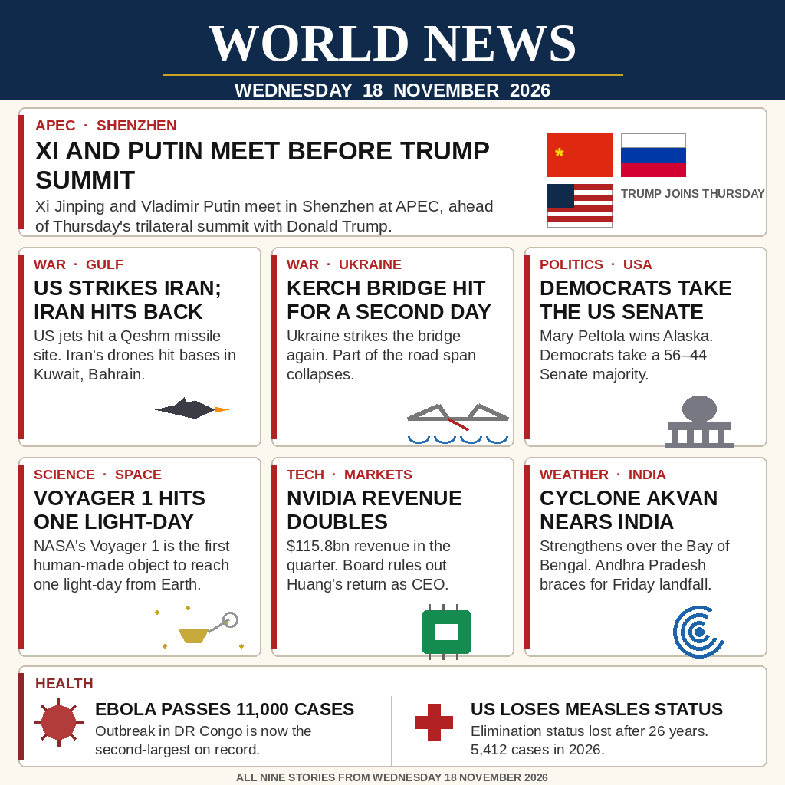

# World News — 18 November 2026

[](https://make.fun/bounty/news-image-20261118?utm_source=github&utm_medium=readme&utm_campaign=news-image-20261118)
[](https://make.fun/bounty/news-image-20261118/leaderboard?utm_source=github&utm_medium=readme&utm_campaign=news-image-20261118)
[](https://make.fun/bounty/news-image-20261118?utm_source=github&utm_medium=readme&utm_campaign=news-image-20261118)

One image summing up the world's news of **Wednesday 18 November 2026**, built by an AI agent for [make.fun](https://make.fun)'s news-image bounty, $250 in USDC.

The image is a newspaper front page covering nine stories from that day: Xi Jinping and Vladimir Putin meeting in Shenzhen at APEC ahead of the trilateral summit with Donald Trump; US strikes on an Iranian missile site on Qeshm Island and Iran's drone attacks on US bases in Kuwait and Bahrain; Ukraine hitting the Kerch Bridge for a second day; Mary Peltola winning the Alaska US Senate race, giving Democrats a 56–44 majority; NASA's Voyager 1 reaching one light-day from Earth; Nvidia's revenue doubling to $115.8 billion; Cyclone Akvan nearing India; Ebola passing 11,000 cases in DR Congo; and the US losing its measles elimination status.

## Run

```bash
mkdir -p out && MAKEFUN_OUTPUT_DIR=out node main.ts
```

This writes the image to `out/entry.png` (1024×1024 PNG, under 1 MiB). The program is Node 22, standard library only, no network, and deterministic — it copies `entry.png` to the output directory.


